<div align="center">

# 🌳 ParseViz

### The interactive LL(1) parsing studio: *watch* top-down parsing instead of memorising it.

[](https://www.python.org/)
[](https://flask.palletsprojects.com/)
[](https://d3js.org/)
[](https://getbootstrap.com/)
[](#-tests)
[](#-deploy-on-render)

**PS-03 · Unit II: Top-Down Parsing**  
Left recursion · Left factoring · FIRST / FOLLOW · LL(1) table · Trace · Animated parse tree

<br>

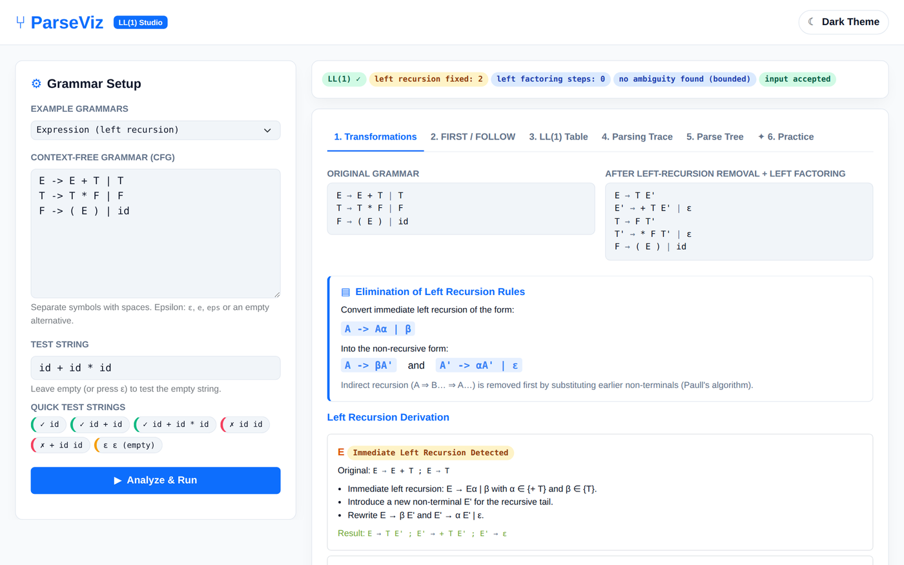

</div>

---

## ✨ Why ParseViz?

Students usually memorise the recipe for removing left recursion without knowing *why*, and FIRST/FOLLOW sets and table cells just appear as answers. A rejected string rarely says **where** or **why** it failed.

ParseViz shows **every** transformation, set addition, table cell, stack move and tree node, then lets students test themselves.

## 🚀 Features

| # | Tab | What you get |
|---|-----|--------------|
| 1 | **Transformations** | Immediate **and** indirect left recursion removed step by step (α, β, new non-terminal). Left factoring by longest common prefix, repeated until none is left. |
| 2 | **FIRST / FOLLOW** | A log of every set addition: pass, production and rule. Hover a symbol to see which production put it there. |
| 3 | **LL(1) Table** | Filled, empty and conflicting cells. Conflicts are typed **FIRST/FIRST**, **FIRST/FOLLOW** or **FOLLOW/FOLLOW**, de-duplicated, with a fix hint. |
| 4 | **Parsing Trace** | Stack, remaining input and action at every step. Rejected input marks the bad token with its position and the expected symbols. |
| 5 | **Parse Tree** | Animated D3 tree driven by the trace: play, pause, step, slider. Partial tree with a red node for rejected input. |
| 6 | **Practice** | New strings are generated; you predict accept or reject, the real parser gives the verdict, score and streak. |

**Extras:** one-click sample strings (valid / invalid / empty) · `id+id*id` without spaces is tokenised automatically · 7 built-in example grammars · bounded ambiguity check · light and dark themes · fixed setup panel and pinned tab bar on desktop.

## 📸 Tour

<table>
<tr>
<td width="50%"><b>Left factoring</b><br>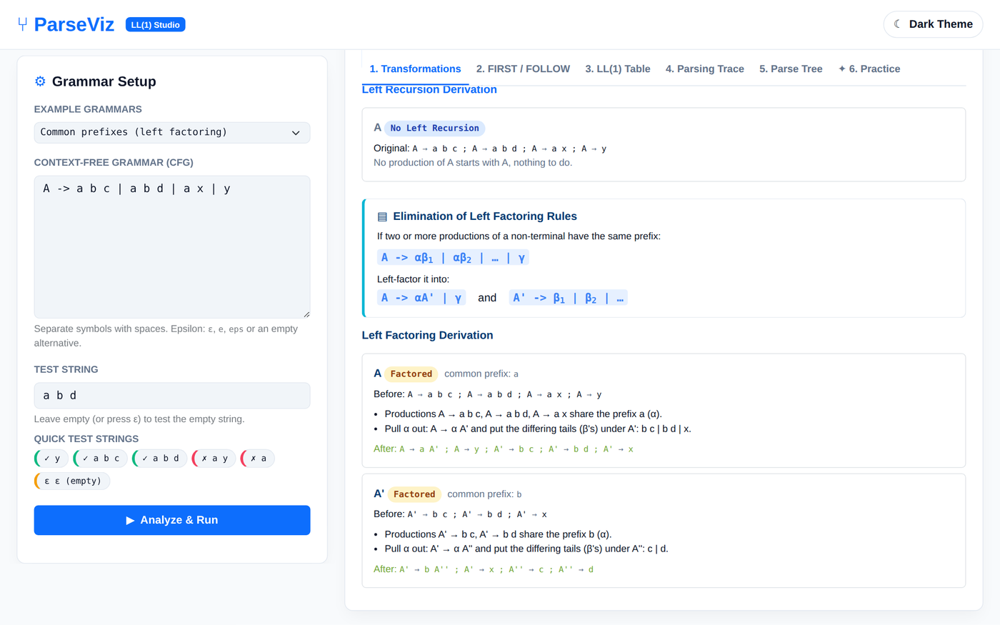</td>
<td width="50%"><b>FIRST / FOLLOW log</b><br>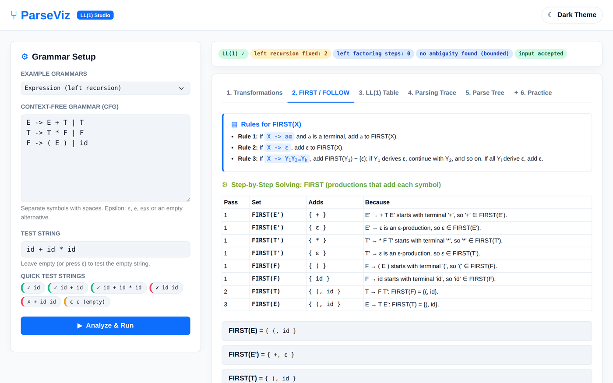</td>
</tr>
<tr>
<td><b>LL(1) table</b><br>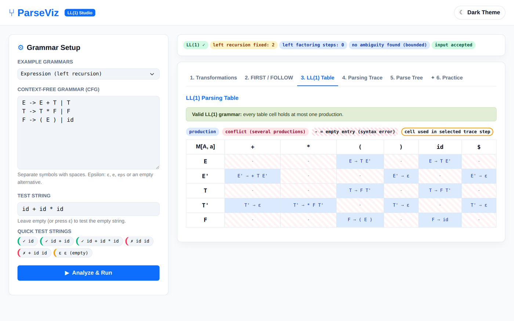</td>
<td><b>Conflict detection (dangling else)</b><br>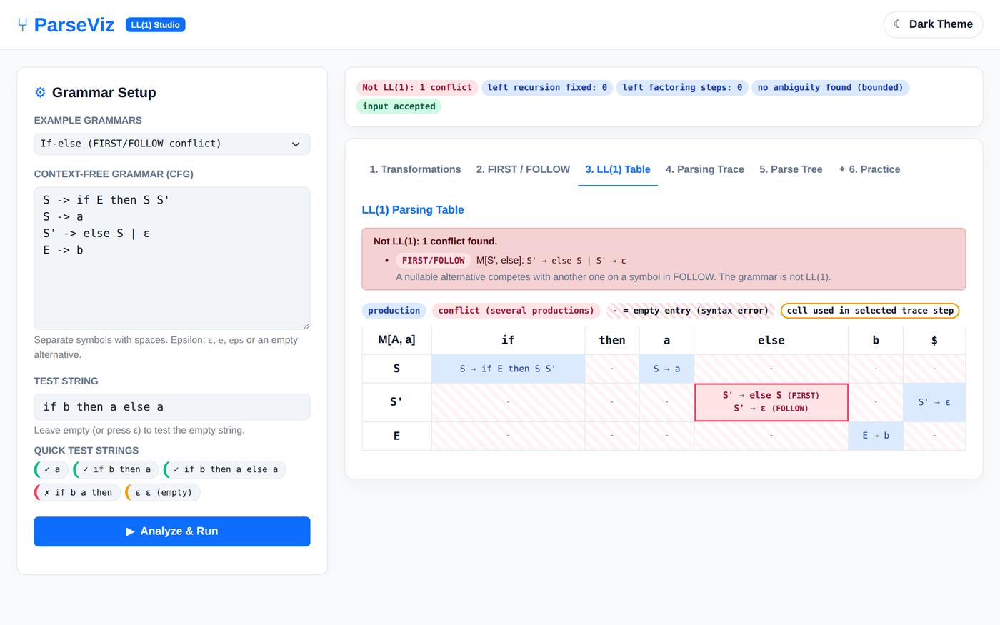</td>
</tr>
<tr>
<td><b>Exact error location</b><br>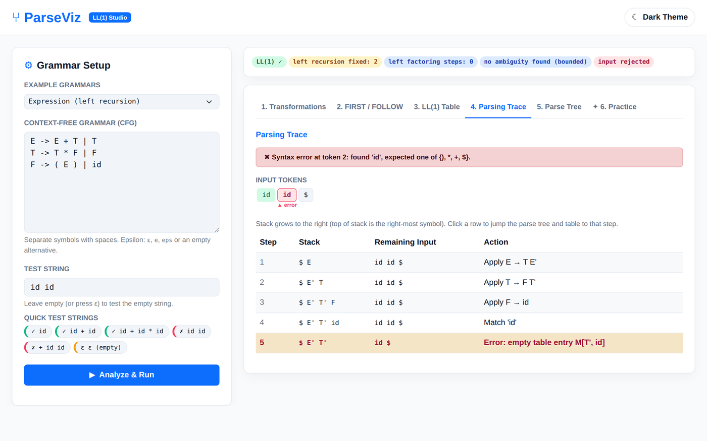</td>
<td><b>Animated parse tree</b><br>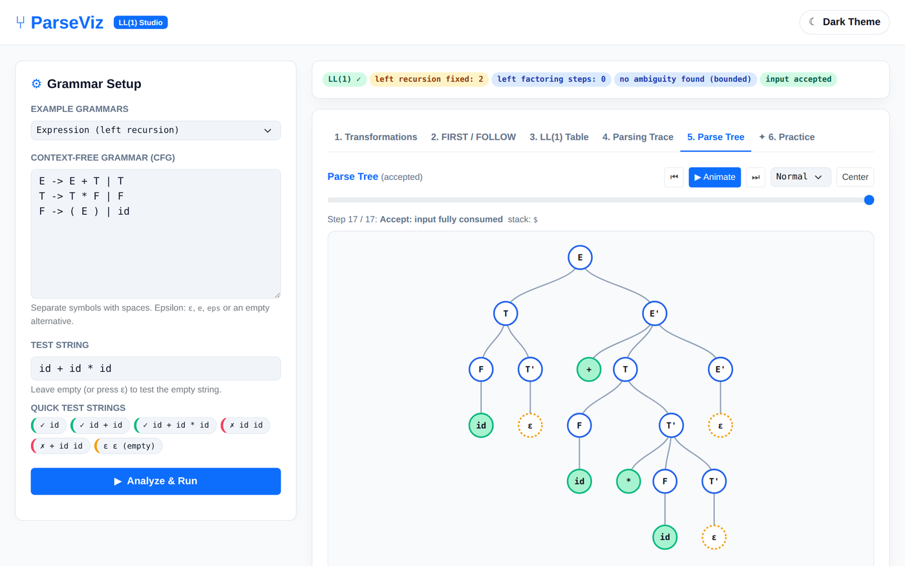</td>
</tr>
<tr>
<td><b>Partial tree on error</b><br>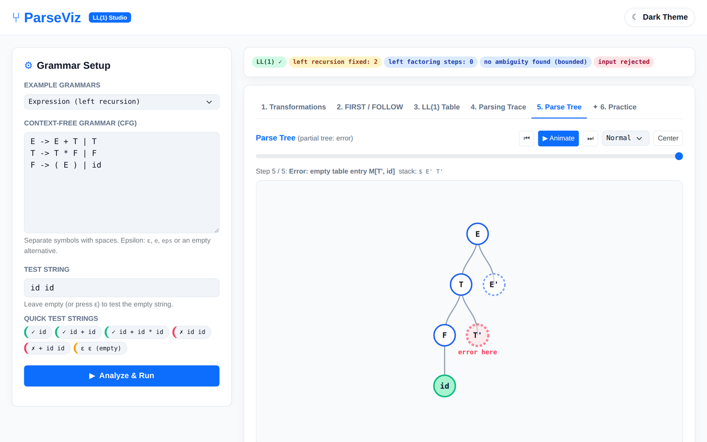</td>
<td><b>Practice mode</b><br>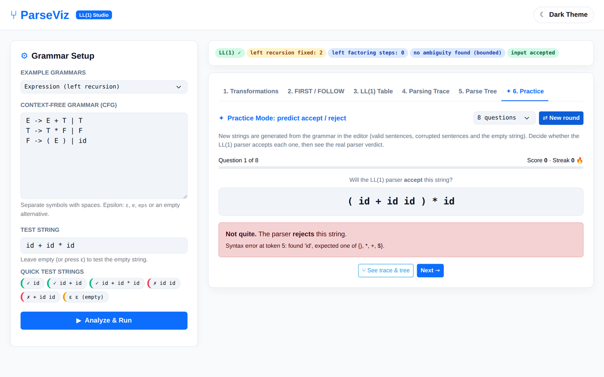</td>
</tr>
</table>

<details>
<summary><b>🌙 Dark theme</b></summary>
<br>
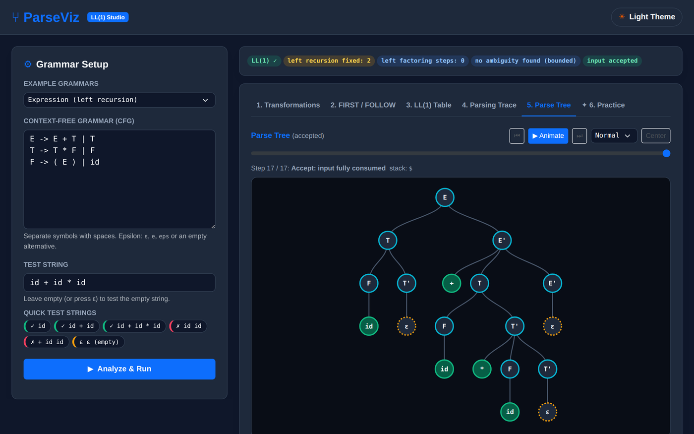
</details>

## ⚡ Quick start

```bash
git clone https://github.com/sphoorthy282007/ParseViz-Interactive-Parse-Tree-Generator.git
cd ParseViz-Interactive-Parse-Tree-Generator
pip install -r requirements.txt
python app.py
```

Open **http://127.0.0.1:5000**. Type or pick a grammar, enter a test string (or leave it empty for ε), click **Analyze & Run**, then walk through tabs 1 to 5 and try tab 6.

> The page loads Bootstrap, D3 and fonts from a CDN, so the browser needs internet access.

## 🔤 Grammar syntax

```
E -> E + T | T
T -> T * F | F
F -> ( E ) | id
```

- One rule per line: `A -> x B | y` (also `→` and `::=`). Alternatives are separated by `|`.
- Separate every symbol with a space.
- Epsilon: `ε`, `e`, `eps`, `epsilon`, `#`, `λ` (alone in an alternative) or an empty alternative. A terminal literally named `e` therefore cannot be used.
- Symbols on a left-hand side are non-terminals; everything else is a terminal. `//` starts a comment line.

## 🏗️ How it works

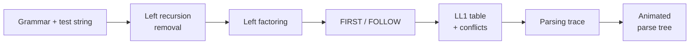

```
app.py               Flask routes: /api/analyze, /api/practice, /api/practice/check
parser_engine.py     All algorithms (no Flask dependency)
templates/index.html Front end (Bootstrap + D3)
tests/test_engine.py Unit tests for the edge cases
Procfile             gunicorn app:app (Render / Railway / Heroku)
```

## 🧪 Tests

```bash
python -m unittest discover -s tests
```

18 tests cover ε-productions and empty input, `A → A a | ε`, indirect left recursion, nested common prefixes, dangling else, several conflicts in one grammar (no duplicates or false conflicts), partial trees on error, practice rounds, bad grammar text, and a guard against non-terminating recursion.

## ☁️ Deploy on Render

1. Push this folder to GitHub (`app.py`, `Procfile` and `requirements.txt` at the repo root).
2. On [render.com](https://render.com) choose **New → Web Service** and connect the repo.
3. Runtime **Python 3**, build command `pip install -r requirements.txt`, start command `gunicorn app:app`.
4. Click **Create Web Service** and you get a public `https://<name>.onrender.com` link.

The same `Procfile` works on Railway and Heroku. On PythonAnywhere, point the WSGI file at `from app import app as application`.

## ⚠️ Limits

- For a grammar that is not LL(1), the parser takes the first alternative of a conflicting cell and warns.
- Indirect-recursion removal assumes no ε-productions among the substituted non-terminals (Paull's precondition).
- The ambiguity probe only searches strings of up to 5 terminals. A hit proves ambiguity; no hit is only evidence.

## 🗺️ Roadmap

- LR / bottom-up parsing views
- Export traces as PDF
- Save a student's practice history

---

<div align="center">

Built for **PS-03 · Compiler Design, Unit II**  
If ParseViz helped you, give it a ⭐

</div>
